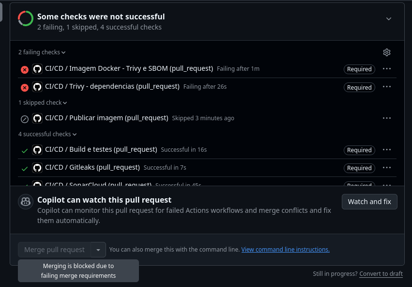
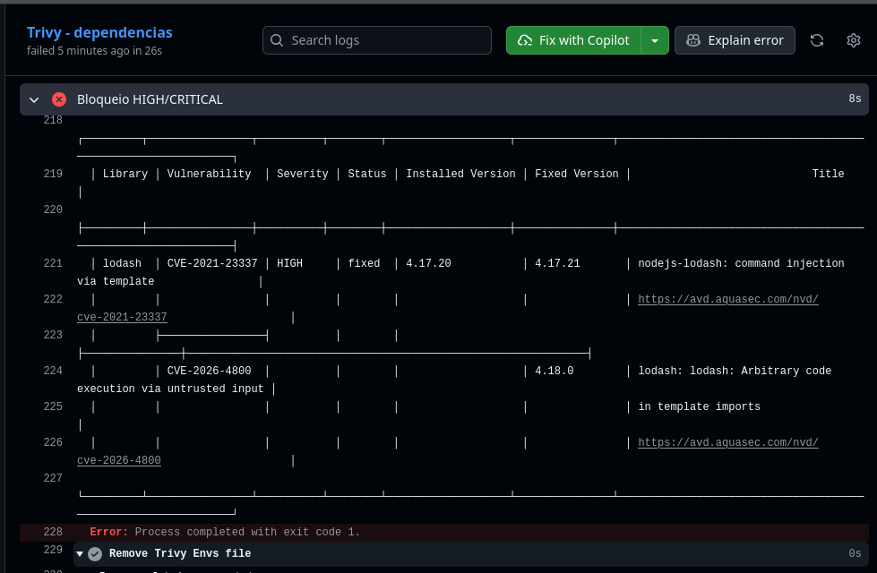
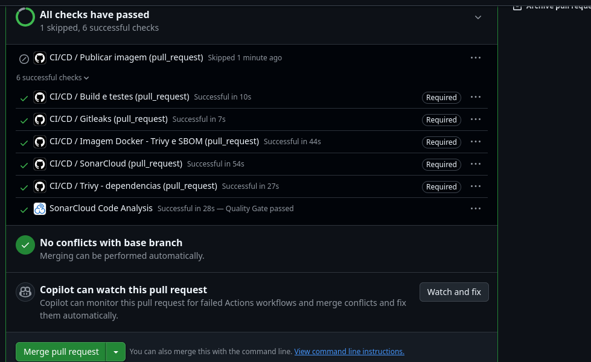

# api-tarefas - Pipeline DevSecOps com GitHub Actions

Trabalho prático da disciplina de DevOps (UFLA). A aplicação é uma API REST simples de tarefas em Node.js/Express, com testes em Jest, empacotada em Docker. Em cima do pipeline de build, testes e publicação da imagem foram adicionadas verificações de segurança que rodam a cada Pull Request para a `main`.

## Aplicação

| Método | Rota | Descrição |
|---|---|---|
| GET | `/health` | health check |
| GET | `/tarefas` | lista tarefas (aceita `?concluida=true/false`) |
| GET | `/tarefas/:id` | busca uma tarefa |
| POST | `/tarefas` | cria tarefa (`{ "titulo": "..." }`) |
| PATCH | `/tarefas/:id` | altera título e/ou `concluida` |
| DELETE | `/tarefas/:id` | remove tarefa |

Rodando localmente:

```bash
npm ci
npm test
npm start            # porta 3000

docker build -t api-tarefas .
docker run -p 3000:3000 api-tarefas
```

## Pipeline

Arquivo: [`.github/workflows/ci.yml`](.github/workflows/ci.yml)

Dispara em `pull_request` para a `main` (abertura, novos commits e reabertura), em `push` na `main` e manualmente.

Ordem dos jobs: `Gitleaks`, `Trivy - dependencias` e `Build e testes` rodam em paralelo. Depois dos testes rodam `SonarCloud` e `Imagem Docker - Trivy e SBOM`. O `Publicar imagem` só começa quando todos terminaram com sucesso.

| Job | O que faz |
|---|---|
| **Gitleaks** | Faz checkout com histórico completo (`fetch-depth: 0`) e procura senhas, tokens e chaves nos commits. |
| **Build e testes** | `npm ci` + `npm test` com cobertura. O `lcov.info` vai como artifact para o job do Sonar. |
| **SonarCloud** | Análise estática (SAST) com cobertura. Usa `sonar.qualitygate.wait=true`, então o job espera o resultado do Quality Gate e falha se ele reprovar. |
| **Trivy - dependências** | `trivy fs` em cima do `package-lock.json`. Gera relatório completo e depois roda o gate. |
| **Imagem Docker - Trivy e SBOM** | Builda a imagem, gera o SBOM com Syft, gera relatório do Trivy da imagem e roda o gate. |
| **Publicar imagem** | Só roda em push na `main` e depende de **todos** os jobs anteriores. Publica no GHCR exatamente a imagem que foi escaneada (salva com `docker save` e enviada com `skopeo copy`), sem rebuild. |

Em PR a imagem nunca é publicada, então uma versão vulnerável não chega no registry.

## Regras de bloqueio

| Ferramenta | Bloqueia quando | Não bloqueia |
|---|---|---|
| Gitleaks | qualquer segredo detectado no histórico do PR/push | - |
| SonarCloud | Quality Gate do código novo reprovado | - |
| Trivy (deps e imagem) | vulnerabilidade **CRITICAL** ou **HIGH** **com correção disponível** (`--severity HIGH,CRITICAL --ignore-unfixed --exit-code 1`) | LOW, MEDIUM e UNKNOWN, e HIGH/CRITICAL sem correção |
| Syft | não bloqueia, só gera o SBOM | - |

Sobre o Trivy: cada scan roda duas vezes. A primeira com todas as severidades e `exit-code: 0`, que gera o relatório (`trivy-deps-relatorio` / `trivy-imagem-relatorio`, salvos como artifact e também mostrados no resumo da execução). A segunda é o gate, filtrado só para HIGH/CRITICAL corrigíveis e com `exit-code: 1`. Assim LOW/MEDIUM ficam registrados mas não param o pipeline.

### Quality Gate (SonarCloud)

Foi usado o Quality Gate **Sonar way**, que é o padrão do SonarCloud e só avalia o **código novo** (New Code). No plano gratuito não dá para criar gates customizados, e o Sonar way já cobre segurança e qualidade. As condições são:

- Security Rating em código novo: A
- Reliability Rating em código novo: A
- Maintainability Rating em código novo: A
- Security Hotspots revisados em código novo: 100%
- Cobertura em código novo: >= 80%
- Linhas duplicadas em código novo: <= 3%

O New Code está configurado como *Previous version*. Em Pull Request, o código novo é o diff do próprio PR.

Obs.: a primeira análise do projeto não calcula o Quality Gate ("Quality Gate not computed"), porque ela vira a referência do código novo. O gate passa a ser avaliado a partir da segunda análise.

### SBOM

O Syft (via `anchore/sbom-action`) gera o SBOM da imagem em formato **SPDX JSON**, com os pacotes do sistema (Alpine) e os pacotes npm com suas versões. O arquivo fica disponível na aba *Artifacts* de cada execução como `sbom-api-tarefas.spdx.json`.

### Imagem

O Dockerfile usa build multi-stage em cima do `node:24-alpine`, instala só as dependências de produção, roda `apk upgrade`, remove npm/yarn/corepack da imagem final (não são usados em runtime e costumam trazer CVEs) e executa como usuário `node`, não root.

## Configuração do repositório

1. **SonarCloud**
   - Importar o repositório em https://sonarcloud.io e pegar a organização e a project key.
   - Atualizar `sonar.organization` e `sonar.projectKey` em [`sonar-project.properties`](sonar-project.properties).
   - Em *Administration > Analysis Method*, desligar a **Automatic Analysis** (senão conflita com a análise pelo CI).
   - Conferir que o projeto usa o Quality Gate *Sonar way* (padrão) e que o New Code está como *Previous version*.
   - Em *My Account > Security*, gerar um token e cadastrar no GitHub como secret `SONAR_TOKEN` (*Settings > Secrets and variables > Actions*).
2. **Gitleaks**: em repositório de conta pessoal não precisa de licença. Se o repositório for de organização, é preciso cadastrar o secret `GITLEAKS_LICENSE`.
3. **GHCR**: usa o `GITHUB_TOKEN` do próprio Actions, não precisa de secret extra.
4. **Proteção da branch `main`** (*Settings > Branches > Add rule*, ou *Rulesets*):
   - Require a pull request before merging
   - Require status checks to pass, marcando: `Gitleaks`, `Build e testes`, `SonarCloud`, `Trivy - dependencias`, `Imagem Docker - Trivy e SBOM`
   - Require branches to be up to date before merging

## Demonstração do bloqueio e da correção

Feito na branch `teste/dependencia-vulneravel`.

**1. Introduzindo a vulnerabilidade**

```bash
git checkout -b teste/dependencia-vulneravel
npm install lodash@4.17.20
git commit -am "adiciona lodash"
git push -u origin teste/dependencia-vulneravel
```

O `lodash` 4.17.20 tem a **CVE-2021-23337** (HIGH, command injection via `template`), corrigida na 4.17.21, e a **CVE-2026-4800** (HIGH), corrigida na 4.18.0. Ao abrir o PR, o job `Trivy - dependencias` falha, e o `Imagem Docker - Trivy e SBOM` também, porque o lodash é dependência de produção e vai para a imagem. O merge fica bloqueado pela proteção da branch (PR #1):

```
package-lock.json (npm)
Total: 2 (HIGH: 2, CRITICAL: 0)

│ Library │ Vulnerability  │ Severity │ Status │ Installed Version │ Fixed Version │
│ lodash  │ CVE-2021-23337 │ HIGH     │ fixed  │ 4.17.20           │ 4.17.21       │
│         │ CVE-2026-4800  │          │        │                   │ 4.18.0        │
```




**2. Correção**

```bash
npm install lodash@4.18.1
git commit -am "atualiza lodash para versao corrigida"
git push
```

O PR roda de novo, todos os checks passam e o merge é liberado.

O PR #1 (onde estão a falha e a correção) acabou fechado sem merge por causa de um ajuste no histórico de commits da branch. O merge foi feito pelo PR #2, aberto a partir da mesma branch e com o mesmo conteúdo.



Obs.: a 4.17.21 resolve a CVE-2021-23337 mas ainda tem a CVE-2026-4800, então ela continuaria bloqueada. Por isso a correção foi direto para a 4.18.1.

## Evidências

Os prints estão em [`docs/evidencias`](docs/evidencias):

| Arquivo | Conteúdo |
|---|---|
| `01-pr-bloqueado.png` | PR com o check do Trivy falhando e merge bloqueado |
| `02-relatorio-trivy.png` | trecho do relatório apontando a CVE |
| `03-pr-aprovado.png` | mesmo PR após a correção, todos os checks verdes |
| `04-pipeline-main.png` | execução completa na `main` com a publicação da imagem |
| `05-sbom-artifact.png` | SBOM disponível nos artifacts da execução |
| `06-sonarcloud.png` | Quality Gate no SonarCloud |

## Estrutura

```
.
├── .github/workflows/ci.yml
├── src/
│   ├── app.js
│   └── server.js
├── test/app.test.js
├── docs/evidencias/
├── Dockerfile
├── sonar-project.properties
└── package.json
```
